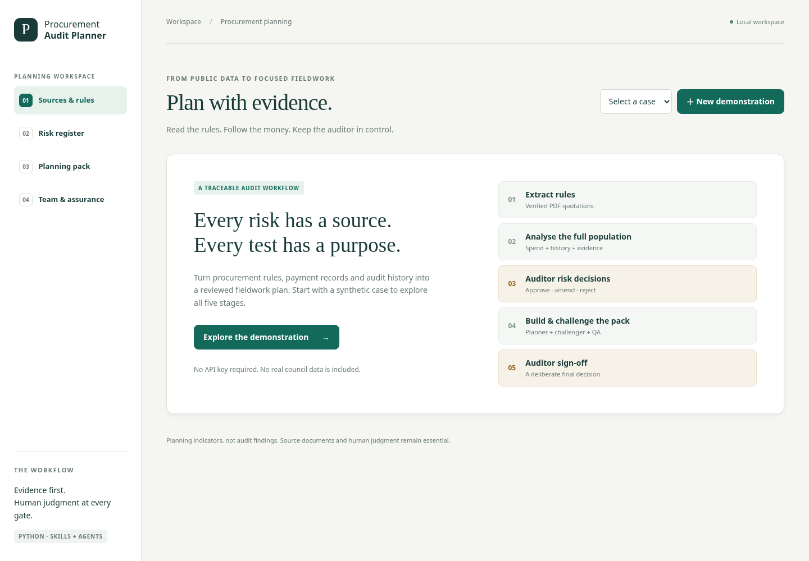
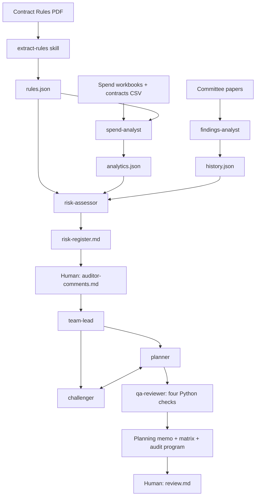

# Procurement Audit Planner — Part A

A Python implementation of the supplied **Skills, Agents & Deployment** assignment. It reads source-quoted purchasing rules, analyses the entire payment population, incorporates historical audit evidence, pauses for human risk decisions, and produces a checked planning pack for a second human sign-off.

**It plans an audit; it does not perform one or reach findings.** The included demonstration is synthetic. No real council data, credentials or actual auditor approvals are included.



## Run the application

Requires Python 3.12+ and [uv](https://docs.astral.sh/uv/). From the repository root:

```bash
uv sync --frozen --extra dev
uv run --frozen uvicorn procurement_audit.web:app --host 127.0.0.1 --port 8000
```

Open the local application on port 8000 in your own browser. Choose **New demonstration**, inspect the rules, then open **Risk register**. A human must decide each risk and enter their name. The team creates the planning documents after those decisions. Read the pack and challenger comments before recording final review.

No API key is needed for the default demonstration. The Python backend uses FastAPI; the browser interface uses HTML, CSS and JavaScript, with no Node build step. This Part A server accepts local hosts. Production hosting, authentication and the Part B deployment are separate work.

Without uv, create a Python virtual environment and run `python -m pip install -e '.[dev]'`. That installs compatible versions; `uv sync --frozen` reproduces the committed lockfile exactly.

## Skills created

| Skill | Responsibility | Output |
|---|---|---|
| [`extract-rules`](skills/extract-rules/SKILL.md) | Read every rulebook page; extract testable rules; verify quotes and thresholds | `rules.json` |
| [`analyse-procurement`](skills/analyse-procurement/SKILL.md) | Coordinate spend/history analysis and risk assessment | `analytics.json`, `history.json`, `risk-register.md` |
| [`build-audit-pack`](skills/build-audit-pack/SKILL.md) | Enforce approval, coordinate the planning team and QA | Memo, matrix, program and pending review |

Each SKILL.md contains discoverable frontmatter, inputs, steps, outputs and stopping conditions. `.claude/skills` links to the reusable `skills/` directory so Claude Code can discover `/extract-rules`, `/analyse-procurement` and `/build-audit-pack`. If Git symlinks are unavailable on your platform, copy those three skill directories into `.claude/skills/` for native discovery.

## Agents created

| Agent | Responsibility | Python implementation |
|---|---|---|
| `spend-analyst` | Full-population metrics and source row provenance | `agents/analysis.py`, `analytics.py` |
| `findings-analyst` | Verified historical coverage, opinions, actions and risks | `agents/analysis.py` |
| `risk-assessor` | Fixed-scale risks citing rules, metrics or history | `agents/analysis.py` |
| `planner` | Controls, procedures, evidence requests and targeted samples | `agents/team.py` |
| `challenger` | Alternative explanations, coverage gaps and sample challenges | `agents/team.py` |
| `qa-reviewer` | Four independent checks that block invalid packs | `qa.py`, `agents/team.py` |
| `team-lead` | Work allocation, messages, revision and completion reports | `agents/team.py` |

Paths above are under `procurement_audit/`. Native Claude Code definitions are in [`.claude/agents/`](.claude/agents/), with individual instructions and allowed tools.

## How they work together



Spend and history workers run independently in a thread pool; the assessor waits for both. After the human gate, planner and challenger work independently. The challenger sends concerns, the planner revises, and QA checks the final pack. All three report to the lead, with messages saved in `team-messages.json`.

Three execution options are explicitly distinguished:

1. **Deterministic / reviewed-candidate mode:** no model calls. Extraction proposals are supplied as JSON and verified against PDFs. Python role workers use documented rules and templates. This is a reproducible architecture demonstration, not a claim that autonomous LLM agents or native Claude teams ran.
2. **Python with LLM assistance:** `--llm` enables rule extraction, history reading, risk narratives, challenger reasoning and planner revisions through an OpenAI-compatible model. Python controls all numeric analysis, scores, sample selection and schedules. Responses cannot change risk/test identities or approved scope. Quotes and thresholds are verified; model prose still requires human review.
3. **Native Claude Code:** the supplied skills and agent definitions can be invoked there. Native team availability depends on the runtime; report unavailable support rather than pretending it ran. Native teams have not been validated in this environment.

## CLI: the five stages

The CLI and web UI share one Python harness. Create a synthetic case with:

```bash
uv run --frozen procurement-audit demo --case .audit-cases/demo
```

This creates PDF, XLSX and CSV sources, completes verified analysis, and **stops at human gate one**. For real data, follow [the data contract](docs/data-contract.md), then:

```bash
# Stage 1: verified extraction; reviewed candidate JSON is the default input.
uv run --frozen procurement-audit extract-rules --case .audit-cases/my-council

# Stage 2: full-population analysis and history review.
uv run --frozen procurement-audit analyse --case .audit-cases/my-council

# Stage 3: a HUMAN edits outputs/auditor-comments.md.
# Set Reviewer; approve/amend/reject EVERY risk. Do not auto-approve.

# Stage 4: the team runs after that decision.
uv run --frozen procurement-audit plan --case .audit-cases/my-council

# Four independently callable checks.
uv run --frozen python scripts/check_quotes.py --case .audit-cases/my-council
uv run --frozen python scripts/check_numbers.py --case .audit-cases/my-council
uv run --frozen python scripts/check_traceability.py --case .audit-cases/my-council
uv run --frozen python scripts/check_samples.py --case .audit-cases/my-council

# Stage 5: only after a HUMAN reviews the complete pack.
uv run --frozen procurement-audit sign-off --case .audit-cases/my-council \
  --reviewer 'Your name' --decision sign_off --comment 'Record your actual review here.'
```

Use `return_for_revision` instead of `sign_off` when appropriate. Review records concern the planning pack, not an audit opinion. The recorded name is a local declaration, not authenticated identity or a digital signature.

Amendments require revised likelihood and impact plus an explanation; rejections require explanations. Missing, duplicate, unknown or pending decisions block planning. Every approved risk must fit the day budget; none is silently dropped. All-rejected scope produces an explicitly empty fieldwork program.

## Optional model configuration

Set `AUDIT_LLM_API_KEY` securely in the process environment. Optional variables are `AUDIT_LLM_MODEL` (default `gpt-4.1-mini`) and `AUDIT_LLM_BASE_URL` (default `https://api.openai.com/v1`). See `.env.example`; `.env` files are **not automatically loaded**. Never commit credentials. `AUDIT_CASES_DIR` sets the web case directory.

Add `--llm` to `extract-rules`, `analyse` and `plan`. Source text and relevant artifacts are sent to the configured HTTPS model endpoint. Without a model, prepare reviewed `rule-candidates.json` and `history-candidates.json` manually or using native Claude Code. Invalid model output stops the stage. Oversized inputs require reviewed candidates instead of silent truncation.

The web demonstration uses deterministic mode. For model-assisted planning of a real case, use the CLI `plan --llm` after the human edits auditor comments. Live provider calls have not been verified because no credential was supplied; model-role contracts are tested with mocks.

## Output pack and provenance

All artifacts live in `CASE/outputs/`:

- `rules.json`, `analytics.json`, `history.json`
- `risk-register.md` and `risk-register.json`
- `auditor-comments.md` — first human gate
- `planning-memo.md` — purpose, population, decisions, approach, exclusions, limitations
- `risk-control-matrix.md` — approved risk → required control → rule → test
- `audit-program.md` — procedures, exact payments/workbook rows and document requests
- `program.json`, `challenge.md`, `team-messages.json`, `qa-report.json`
- `review.md` — second human gate; `signoff.json` exists only after an explicit review action

State files bind analysis to source hashes and the pack to the decisions/documents. Changes invalidate downstream use. Analysis reruns archive prior outputs and reset approvals. Local cases are gitignored to avoid inadvertently committing real flagged payments.

## Validation and assignment completion

```bash
uv run --frozen pytest -q
uv run --frozen ruff check .
uv run --frozen ruff format --check .
```

Tests cover the full synthetic workflow, exact indicator rows/totals, credits, window boundaries, quote/threshold verification, missing inputs, human gates, amendments/rejections, tampering, budget limits, model boundaries and HTTP exports. Automated approvals occur only in explicitly synthetic tests, not in the demonstration left for human review.

The [validation record](docs/validation.md) records the 25 passing tests, browser workflow and package checks. GitHub Actions runs the Python checks on pushes and pull requests.

See [the guide completion matrix](docs/guide-checklist.md). The reference site was blocked by the environment proxy. The supplied overview describes the architecture and objectives but does not contain all 27 lesson prompts or original council download links. This implementation therefore does **not** certify that all 27 prompts were replayed, that native Claude teams ran, or that a real council pack was approved. Public-data validation and actual auditor decisions remain outstanding.

Part A's deliverable is this repository with implementation and documentation. Part B's deployed website URL is outside this request.
