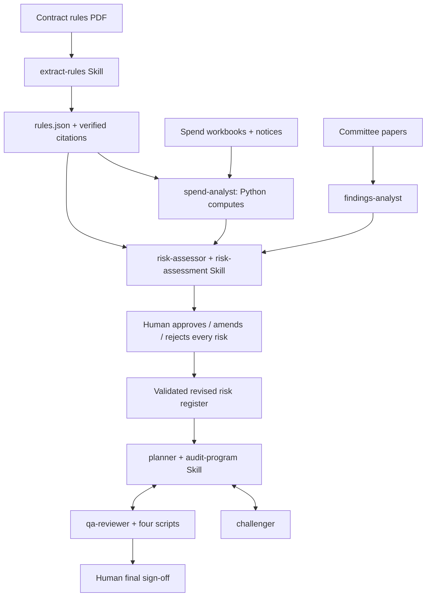

# Procurement Audit Planner — Skills, Agents & Independent Harness

Implementation of the [course build guide](https://procurement-audit-planner.vercel.app/)
using West Berkshire Council's supplied public procurement data. The project
prepares an audit planning pack; it does not perform an audit or allege wrongdoing.

## Open it as an online website

[](https://render.com/deploy?repo=https%3A%2F%2Fgithub.com%2Fgengtong0601-hub%2Fprocurement-audit-planner)

Click **Deploy to Render**, sign in with GitHub, authorize this repository, and
create the service from `render.yaml`. The blueprint selects **Free**, starts
the production Gunicorn server and checks `/health`. The prepared-evidence
workflow needs no API key. Render displays the public website URL after the
build finishes. This button opens hosting setup; it is not an already-deployed URL.

免费版部署步骤见 **[中文上线说明](docs/ONLINE_SETUP.md)**。免费服务可能休眠，
运行记录会在重启或重新部署后丢失；完成审阅后请下载规划包保存。

**交接请先看：[Claude Code 验证清单](docs/CLAUDE_VERIFICATION.md)。**
这份项目已经准备 Claude 架构、真实来源数据、可运行分析脚本和独立网页 harness。
本地准备和测试由 Codex 完成；不能据此声称 Claude 原生运行、真人审批或线上部署已完成。

## Submission status

| Deliverable | Status |
|---|---|
| Part A implementation and README | Prepared locally; see skills, agents and guide mapping below |
| Native Claude Code execution evidence | **Pending teammate verification** |
| Real auditor scope decisions and final sign-off | **Pending human review**; root outputs are unapproved drafts |
| Part B independent web harness | Implemented locally, with prepared demonstration and live API modes |
| Live Claude API run and hosted end-to-end verification | **Pending credentials and deployment** |
| GitHub repository URL | https://github.com/gengtong0601-hub/procurement-audit-planner |
| Deployed website URL | Pending owner sign-in and service creation through the Render button above |

All work is saved in this project folder. The user's requested handoff excludes
native Claude Code validation; no completed-task claim is inferred from file
presence, website checkboxes, sample transcripts or automated test approvals.

## Run locally

Python 3.11+ is required; cloud validation uses Python 3.12 and the container uses 3.13.
On a different computer, recreate `.venv` instead of copying it.

```bash
python3 -m venv .venv
.venv/bin/python -m pip install -r requirements.lock.txt
.venv/bin/python -m pytest -q
.venv/bin/python -m harness.app
```

Open **http://127.0.0.1:8000**. Choose **Prepared evidence demonstration** to
inspect the complete review workflow without an API key. It transparently uses
prepared judgments and real computed evidence, not a simulated claim of live
Claude execution. Reviewer decisions and sign-off happen only when the person
using the interface explicitly supplies them. Every run is isolated under
`runtime/runs/`, leaving the root draft evidence unchanged.

Live mode uses server-side `ANTHROPIC_API_KEY`, `ANTHROPIC_MODEL` and
`HARNESS_ACCESS_TOKEN`. It performs actual model calls through a custom harness.
See [deployment and verification](docs/DEPLOYMENT.md) before enabling it.

## Skills created

| Skill | Files and responsibility |
|---|---|
| `extract-rules` | `.claude/skills/extract-rules/SKILL.md` and `verify_quotes.py`: enumerate testable PDF rules, preserve quoted evidence and unresolved parameters, verify schemas and exact source pages |
| `risk-assessment` | `.claude/skills/risk-assessment/SKILL.md` and `build_register.py`: validate sourced risk judgments, calculate likelihood × impact, resolve metric placeholders, render the register and blank human decision template |
| `audit-program` | `.claude/skills/audit-program/SKILL.md` and `build_pack.py`: enforce approved scope, validate controls/tests/citations, draw source-linked samples and render the planning pack |

The extract-rules skill is human-invoked; the other skills are methods loaded by
the appropriate agents. Skills are actual instruction packages plus executable
verifiers/builders, not just labels in a web UI.

## Agents created

| Agent | Role and owned output |
|---|---|
| `spend-analyst` | Writes/runs Python over the full population; `analytics.json` and full CSV evidence lists |
| `findings-analyst` | Reads committee evidence, assurance opinions, source gaps and council scoring method; `history.json` |
| `risk-assessor` | Combines rules, analytics and history, loads risk-assessment, proposes ratings and applies explicit auditor changes |
| `planner` | Loads audit-program; owns plan judgments, memo, risk-control matrix, audit program and samples |
| `challenger` | Challenges unsupported scope/rating/planning assumptions using cited evidence; owns `challenges.md` |
| `qa-reviewer` | Runs quote, number, traceability and sample checks; owns `review.md` and blocks failed packs |

Definitions live in `.claude/agents/`. Native team enablement is in
`.claude/settings.json`. The team protocol preserves `PACK READY`, bounded
challenge rounds, direct teammate messages and the three DONE notifications.
Actual Claude discovery, delegation, memory and messaging must be verified in
Claude Code; preparing these definitions is not proof of their execution.

## How they work together



LLMs read evidence and make explicit judgments. Python performs cleaning,
all money calculations, scoring, sampling and validation. Data is immutable;
decisions are separate from evidence. Missing/malformed inputs stop the affected
workflow, and unknown statutory thresholds stay null. Known, printed local
boundaries can still support explicitly limited indicators.

## Data and prepared evidence

The nine supplied files include a 15-page rulebook, three monthly spend
workbooks, one raw notices CSV and four committee PDFs. Original file hashes
are recorded in `data/manifest.json`; sources and reuse are documented in
[SOURCES.md](docs/SOURCES.md).

Prepared rule extraction contains **80 rules**, **81 explicit exclusions** and
**four unresolved statutory parameters**. All numbered clauses and appendix
rows are accounted for. The independent quote checker validates source pages.
The history extraction preserves council opinions, the complete rating matrix
and disclosed contradictions, without inventing unavailable agreed-action
lists or the confidential strategic risk register. See
[extraction notes](docs/EXTRACTION_NOTES.md).

Spend scripts locate each workbook's header, preserve its source row, apply
explicit date formats, normalize suppliers and explode packed notice suppliers.
All exclusions and uncertain matches remain inspectable. The analysis includes
threshold clustering, rolling split-purchase windows, duplicate groups, notice
coverage, post-expiry indicators and eligible spend-to-award ratios. A high-value
supplier list supports fieldwork even when coverage cannot be concluded.
See [the data profile](docs/DATA_PROFILE.md) for actual counts and limitations.

Contracts Finder notices are **not a complete contract register**. Near matches
are candidates, not confirmed matches. Redacted labels do not identify one
supplier. Payment-run dates are not invoice dates. Annualised figures are
estimates. No indicator proves a breach.

## Reproduce the deterministic work

```bash
.venv/bin/python scripts/clean.py
.venv/bin/python scripts/analyse.py
.venv/bin/python scripts/selfcheck.py
.venv/bin/python .claude/skills/extract-rules/verify_quotes.py outputs/rules.json data/contract-rules.pdf
.venv/bin/python scripts/verify_history.py outputs/history.json data/committee
.venv/bin/python .claude/skills/risk-assessment/build_register.py
.venv/bin/python -m pytest -q --basetemp runtime/test-temp
```

The source verifiers consistently use the pinned `pypdf` extractor even when
Poppler is installed, so a hosting machine cannot silently change quote matching.
PDF source text and
visual spot-check images are saved under `docs/reference/`. For literal tutorial
commands, the teammate can install Poppler as described in the handoff.

Before human decisions, this command **must fail with a blocked gate**:

```bash
.venv/bin/python .claude/skills/audit-program/build_pack.py --gate
```

After the human reviewer records decisions and risk-assessor applies them as
a validated revision, the planner writes `audit-plan.json`, then:

```bash
.venv/bin/python .claude/skills/audit-program/build_pack.py
.venv/bin/python scripts/checks/run_checks.py
```

The genuine root output folder deliberately has no final approved pack before
those human actions. Automated tests use isolated temporary runs with names
such as `TEST REVIEWER`; they never approve the real root case.

## Guide completion confirmation

The guide has **27 checklist items: two prerequisites plus 25 numbered steps**.
The following is a transparent preparation record, not a claim that all native
Claude sessions or human approvals already occurred.

| Guide stage | Local preparation | Still to verify / complete |
|---|---|---|
| Prerequisites + 1.1–1.5 Setup | Project, exact brief, source data, dependencies and folders | Teammate's installed/signed-in Claude and session understanding |
| 2.1–2.2 Skills | Rule Skill, verifier, complete prepared extraction, source checks | Native `/extract-rules` run and teammate spot-check |
| 3.1–3.7 Sub-agents | Three definitions, scripts, evidence, scoring Skill and draft register | Actual Claude delegations, memory, independent judgments and reruns |
| 4.1–4.3 Human gate | Blank decision template and strict revision checks | Real approve/amend/reject and Claude applying decisions |
| 5.1–5.8 Agent teams | Team configuration, three teammates, plan builder, four QA checks | Native messaging and lifecycle, approved pack, human sign-off |

For step-by-step prompts, expected evidence and an editable completion log, send
your teammate **[CLAUDE_VERIFICATION.md](docs/CLAUDE_VERIFICATION.md)**. Once those
steps are genuinely completed, update this section with the actual verifier,
date and evidence links. Do not simply change the status to complete.

## Deployment and repository layout

`Dockerfile`, `.dockerignore`, `.env.example` and a free-plan `render.yaml` are
included. Follow [DEPLOYMENT.md](docs/DEPLOYMENT.md) for deployment, persistent
storage, live-call configuration and the required hosted smoke test. Docker
build/deployment is not claimed where Docker or a host account is unavailable.

```text
CLAUDE.md                    exact course project brief
.claude/skills/              three instruction + script packages
.claude/agents/              six role definitions
data/                       immutable course inputs and hash manifest
scripts/                    deterministic cleaning, analysis and source checks
scripts/checks/             four pack checks and their runner
outputs/                    prepared, unapproved root evidence
harness/                    independent web UI, API and orchestration
tests/                      meaningful data, gate and harness tests
docs/                       teammate handoff, provenance and validation notes
runtime/                    ignored isolated web runs and test artifacts
```

Guide-derived code is attributed in [IMPLEMENTATION_NOTES.md](docs/IMPLEMENTATION_NOTES.md).
No new licence is asserted over the supplied course materials.

Local verification: **42 automated tests passed**, source quotes and history
checks passed, and the genuine human gate remains closed to planning. See
[VALIDATION.md](docs/VALIDATION.md) and its saved logs for evidence and limits.
